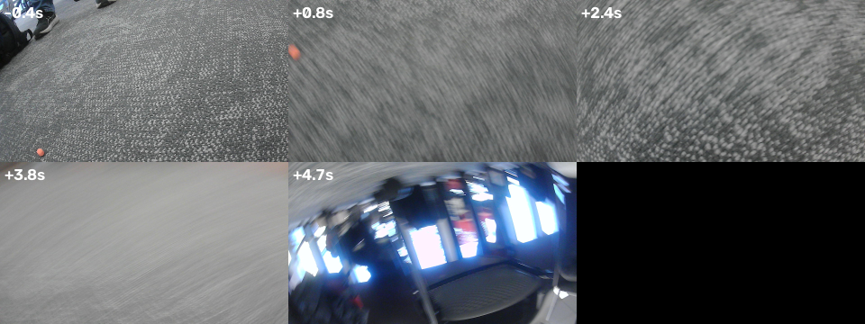

# First hardware test of the dock button, 2026-11-20

First run of **N Dock to ball** (`seepick.py --color orange --dock-only`) on the real duck, installed per
`DOCK-ROBOT-INSTALL.md` (its fallback path: no robotics checkout on the test machine). **Result: 3 runs, 0 docks,
1 fall.** The cause is the camera hand-off in the runtime (`seepick.py` / `ball_detect.py`), not the dock models and
not outside interference: the dock commander was given "ball not visible" for essentially the whole dock. F Small
step was not tested by Claude; whether it was pressed during the session is not recorded here.

Logs: `cmu/real-logs/robot-runs-20261120-dock/` (brain log rows around each run, the dock traces, the brain's run
record and console output, and a strip of camera frames from run 3).

## Setup

- **Staged, not installed.** The A7Z's `guide/firmware/mac` files match no commit in this repo (`walk_brain.py` has
  recurrent-policy support this repo lacks; `walk_wired.py` and `seepick.py` predate `2179f0aa`). Whole-file copies
  would have lost work, so the dock/step diff (`2179f0aa..e3012ce8`) was applied as a patch onto the A7Z's own files:
  one `walk_brain.py` hunk was placed by hand after the recurrent-policy block, and `write_run_meta` was ported into
  `walk_wired.py` (the preflight reads its `.meta.jsonl`). The result lives in `~/dock-stage/` on the A7Z (links to
  the live `pi/` and hardware trees), started by `~/dock-stage/run.sh`, a copy of `~/duck-run.sh` that only changes
  the `cd`. The live `~/rt` tree was not modified.
- **Models folder.** The app's brain loads `~/duck-policy` = `~/policies/b4-seed1-best`, not the runtime-overlay
  folder the checklist expected. `nudge61.onnx` and `dock_commander.onnx` were added there (new files; same 61-input
  layout and `default_joint_pos` as its `walk61.onnx`; checksums match this repo). `seepickpix_dk61.onnx` was not
  copied (only `--dock` needs it).
- **Tests on the A7Z (staging).** All four files compile; `Brain` loads `nudge` and the commander and lists the
  `dock` / `step` modes. `test_dockpick.py`: 27/27 with the runtime-overlay models + the three new files, 25/27
  against `b4-seed1-best` (the two failures need `seepickpix_dk61.onnx`, kneel only). The A7Z ships no tests; their
  helpers (`test_approach.py`, `test_seepick.py`, `test_teleop_modes.py`) were copied into staging only. Running the
  A7Z's own `test_walk_wired_battery.py` / `test_stance_switch.py` alongside the live brain stalled at ~1 % CPU,
  likely waiting on the hardware lock; it was stopped.
- **Preflight** passed (`brain running`, `brain runs this checkout's walk_brain.py`, `dock policy files loaded`).
- **Remote.** Run from this repo's `cmu/simulator/app` with `MICRODUCK_A7Z_MAC=~/dock-stage/microduck-sim/guide/firmware/mac`
  (new optional override in `a7z-bridge.mjs`; default unchanged) so the N button runs the staged `seepick.py`.
  `robot-remote` and `robot-thermal` page tests pass.

## Runs

| Run | Start | What happened |
|---|---|---|
| 1 (16:03, partner) | ball x 0.27 y 0.04 (27 cm, about straight ahead) | find and aim fine; dock started, `visible` = 1 for the first ~0.1 s only, the commander went forward (up to 0.4) for ~1.2 s then near zero; ball "not seen for 3.0 s", run ended. Upright throughout (tilt under ~7 deg). |
| 2 (16:06) | ball measured at 0.80 m | refused before stepping: "beyond the dock's 0.5 m" (the ball had been moved after run 1). |
| 3 (16:10) | ball x 0.15 y 0.32 (36 cm, bearing +66 deg) | `visible` = 0 for the **whole** dock, box frozen at the 1.4 s-old aim sighting (age climbs to the 2.0 s cap). Commander alternated forward/back, head yaw swept -0.45..+0.8; the camera lost the ball (strip below). Tilt rose to ~23 deg, the nudge's actions grew to 8.25 rad, walk_wired tripped `policy action over 3.0 rad in 3 of the last 10 ticks`, then the zero-walk tripped `body tilt over 30 deg`: **fell**. |

Run 3 camera at -0.4 s (ball bottom left), +0.8 s (ball at the left edge, motion blur), +2.4 s and +3.8 s (ball out of
the picture), +4.7 s (falling).

**Not interference.** Leg load (`hold.load`) read 1.00 throughout both docks, so nobody was holding or lifting the
duck; the ball was inside the trained range (bd-wide: 4-50 cm, +-90 deg); nothing but the ball was tracked.

## Cause

Two runtime defects, both outside what `brain_sim_check.py --sp-dock` exercises (its `PixCamera` hands the brain a
box directly and never runs `seepick.measure()`, `pix_box()` or `BallDetect`):

1. **`seen` is a wall-clock freshness test that the real camera never passes.** `seepick.pix_box()` sets
   `seen = now - t_cap < PIX_SEEN_S` (0.15 s). Measured on the A7Z, sightings reach `measure()` 0.16-0.18 s after
   capture (1.3-1.4 s for the first after a head move), and later still when the brain consumes them. So the box
   almost always arrives with `seen: false` and the commander's `visible` slot reads 0. The sim, and
   `walk_brain.seepickpix_body`'s docstring, define `seen` as "the newest processed frame had a detection", which
   stays true through a 0.1-0.3 s delay.
2. **Late detections are dropped while docking.** `measure()` calls the detector with `late_ok` only in aim. In dock,
   `BallDetect` returns only colour boxes within `TRACK_PX` (110 px) of the last confirmed sighting; the learned
   pass's slower confirmations are discarded. Once the head sweeps, the ball moves more than 110 px in the picture
   and the track is lost for good.

The models' share is secondary: a commander that never sees the ball behaves out of distribution (expected), and
the nudge became unstable under jerky commands with the head (about 38 % of body mass) swinging. The nudge was
stable in every sim dock (peak tilt 6-25 deg).

## Next steps

1. `pix_box()`: `seen` from whether the newest processed frame produced a sighting; leave staleness to the `age`
   slot, which already carries it.
2. `measure()` in dock: accept late learned-pass sightings with their own capture time (as aim does); revisit
   `TRACK_PX` / re-seed the track while the head moves.
3. Unit test in `test_dockpick.py`: sightings 0.17 s old must reach the brain with `seen: true`; a late learned
   sighting during dock must update the box.
4. A sim harness that routes `PixCamera` frames through the real `DockPick` -> `BallDetect` (with a slow fake learned
   pass, 0.16-0.18 s per sighting, 1.3-1.4 s after head moves) -> `pix_box()` path. The current `--sp-dock` passes
   with or without the fix.
5. On the duck, a dock **held off the ground** with the ball in view: `dock_cam[4]` (visible) in the brain log should
   stay 1. Only then a floor run, spotted.

## State left on the A7Z

- The live brain was restarted on the normal code (`~/duck-run.sh`) before hand-off.
- `~/dock-stage/` (staged dock/step code) and `nudge61.onnx` / `dock_commander.onnx` in `~/policies/b4-seed1-best`
  remain; the live brain ignores them. To use the staging brain again: `~/dock-stage/run.sh stage<MMDD-HHMMSS>`.
- An app-started brain (supply switch, reboot) always runs the live code, where F and N do nothing.
